# Massion AgentOS 현재 아키텍처

> **문서 상태**: 개인용 데스크톱 통합 전 현재 코드 지도
> **기준일**: 2026-07-24
> **제품 구현 기준**: 공개 `main` 브랜치의 현재 코드·테스트·운영 문서
> **진행 근거**: [요구사항 추적표](../generated/requirements-traceability.tsv)와 Phase 24~28 문서
> **릴리스 상태**: 공개 릴리스 없음. 과거 `v1.0.0`은 철회됐으며 다음 메인 릴리스 목표는 개인용 macOS arm64 데스크톱입니다.

> **제품 정체성 정본:** [Massion 제품 헌법과 현재 방향](../product/constitution.md). 이 문서는 현재 구현 구조를 설명하며 제품의 목적과 철학을 다시 정의하지 않습니다.

> **이 문서보다 나중에 승인된 결정:** [ADR-001 개인용 전체 권한](ADR-001-personal-full-access.md)(2026-07-25, 2026-07-30 개정) · [ADR-002 지식 축과 표면 복원](ADR-002-knowledge-axis-restoration.md)(2026-07-27) · [ADR-003 작업 인지 모델 배치](ADR-003-task-aware-model-placement.md)(2026-07-28). 아래 그림과 표는 기준일 2026-07-24 시점이므로 세 결정이 반영돼 있지 않습니다. 표면 집합(아홉)과 모델 배치는 헌법 §6과 각 ADR이 정본입니다.

이 문서는 Massion을 처음 접하는 사람과 구현 에이전트가 현재 구현 전체를 빠르게 파악하도록 돕습니다. 현재 공개 저장소에 존재하는 코드와 검증 가능한 동작을 같은 그림에 표시하되 상태를 명확히 구분합니다. 세부 계약은 도메인 코드·테스트, 운영 문서와 현재 Phase 문서가 소유하며, 이 문서는 그 관계를 연결하는 지도입니다.

현재 동작은 실제 코드·테스트, 운영 문서, 현재 Phase 설계·회고 순으로 판정합니다. 새 저장소 전환 때 제외한 과거 Phase 문서나 대체된 개념도는 현재 구현 완료의 근거로 사용하지 않습니다. 과거 계보에서 확인된 제품 의도는 [제품 헌법](../product/constitution.md)이 보존합니다.

## 1. 읽는 법과 상태 범례

| 시각 표현 | 상태 | 의미 |
|---|---|---|
| 녹색 실선·`구현됨` | 구현됨 | 현재 저장소에 코드와 관련 테스트·검증 근거가 있음 |
| 파란색 굵은 실선·`구현 중` | 구현 중 | 코드가 존재하지만 현재 Phase 완료 검증 전 |
| 회색 점선·`예정` | 예정 | 개인용 메인 릴리스 범위이나 아직 구현되지 않음 |
| 주황색 이중선·`외부` | 외부 시스템 | Massion이 소유하지 않는 서비스·저장소 |

굵은 화살표는 사용자 Work의 주 실행 경로, 일반 실선은 동기 명령·직접 호출, 점선은 이벤트·관찰·정책 영향을 뜻합니다. 원통은 영속 저장소, 큰 경계 상자는 프로세스 또는 배포 단위입니다. 색상을 볼 수 없는 환경에서도 상태 라벨과 선 모양으로 구분할 수 있습니다.

그림의 구현 상태는 과거 Phase 번호만으로 판정하지 않고 현재 코드와 검증 결과를 함께 확인합니다. 새 저장소에는 Phase 24 이후의 유지보수·전환 문서만 남아 있으며, 외부 권한이 필요한 실제 계정·공개 tag·OIDC·cluster 검증은 실행하지 않은 범위를 성공으로 표시하지 않습니다.

## 2. 전체 시스템 지도

Massion은 사용자 요청을 일회성 채팅이 아닌 영속 업무(Work)로 만들고, 조직이 계획·조사·실행·검증·기록·개선을 분담하는 AgentOS입니다. 현재 메인 표면은 데스크톱이며 CLI는 headless 운영 코드입니다. 레거시 TUI와 Web Console은 제품·배포·세션 API와 함께 제거됐습니다. 데스크톱의 실제 Application 계약 연결은 Phase 30에서 진행 중입니다.

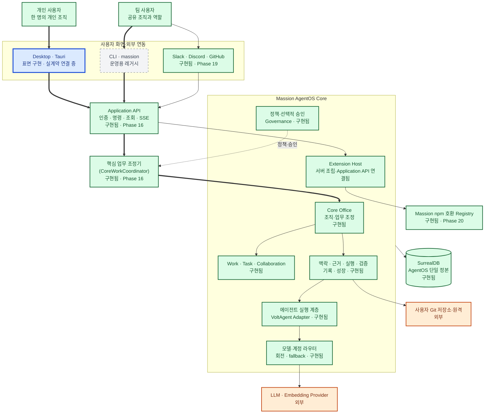

| 요소 | 상태 | 실제 위치 | 근거 |
|---|---|---|---|
| Desktop | 구현 중 | `apps/desktop` | 표면·fixture 테스트는 존재, 실제 Core·Application 연결과 Tauri UAT 진행 중 |
| CLI·Application API | 레거시 운영 경로·구현됨 | `apps/cli`, `packages/application` | 명령·조회·인증·이벤트 테스트 |
| 레거시 TUI·Web Console | 제거됨 | — | 저장소·패키지·배포·세션 API 경계 테스트 |
| Core Office·Work·Governance | 구현됨 | `packages/organization`, `packages/work`, `packages/governance` | 조직·업무·승인 통합 테스트 |
| Runtime·Router | 구현됨 | `packages/runtime`, `packages/router` | 모델 생성·실행·라우팅 실패 테스트 |
| Extension Host | 구현됨 | `packages/extension-host`, `apps/server` | 수명주기·Gateway·Registry 설치기와 Application API 조립, 서버 통합 테스트 |
| Slack·Discord·GitHub Surface | 구현됨 | `packages/integrations`, `extensions/slack`, `extensions/discord`, `extensions/github` | 공식 통합 계약 테스트 |
| Registry·Marketplace | 구현됨 | `packages/registry`, `apps/cli` | 게시·정책·검색·설치 테스트 |
| SurrealDB 단일 정본 | 구현됨 | `packages/storage` | transaction·schema·migration 테스트 |

## 3. 제품 구성요소와 패키지 경계

각 패키지는 자신이 소유한 도메인 불변량을 검사합니다. Application 계층은 공개 서비스를 조합하지만 Work revision, tenant 격리, 정책, 승인, 증거 계보를 대신 판정하지 않습니다. VoltAgent는 실행 메커니즘이며 Massion의 공개 계약으로 노출되지 않습니다.

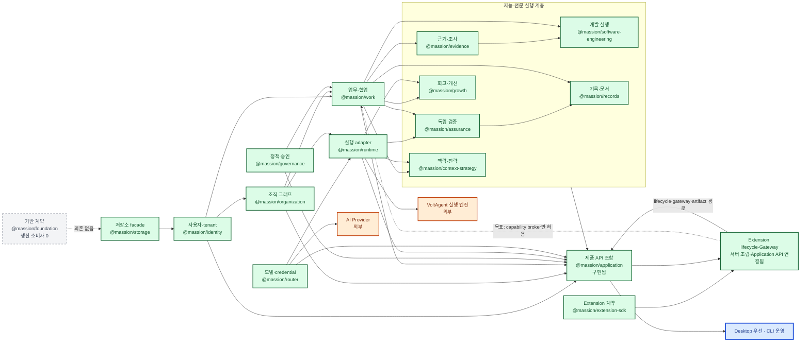

| 경계 | 규칙 | 실제 위치 |
|---|---|---|
| 데이터 | SurrealDB SDK 타입은 저장소 facade 위 도메인 계약에 노출하지 않음 | `packages/storage` |
| 실행 | VoltAgent 타입은 Runtime adapter 내부에 격리 | `packages/runtime` |
| 제품 API | 도메인 공개 서비스만 조합하고 raw store를 반환하지 않음 | `packages/application` |
| Extension | 설치·업데이트·목록·Registry 설치는 Application API가 Host Gateway로 조합한다. worker는 일반 Node child process이며, OS sandbox·VM·Apple signing을 기본 강제하지 않는다. 대신 승인된 manifest 권한, 출처·artifact 계보, 제한된 RPC와 감사 기록이 경계가 된다. | `packages/application`, `packages/extension-sdk`, `packages/extension-host`, `packages/registry`, `apps/server` |

## 4. Core Office와 전문 조직

Core Office는 현재 구현에서 모든 tenant 조직에 생성되는 제거 불가능한 여덟 개 내장 노드입니다. 이는 운영 책임의 기본 투영이지 사용자에게 보이는 전체 조직을 여덟 노드로 제한한다는 뜻은 아닙니다. 조직 노드는 영속하지만 LLM 프로세스가 항상 실행되는 것은 아니며, Work가 필요로 할 때 Agent로 materialize됩니다. Software Engineering Profile은 코드에 포함된 비내장(non-builtin) 전문 조직이지만 현재 생산 Bootstrap에서 자동 설치하지 않습니다. Extension의 설치 수명주기와 worker 실행은 서버와 Application API에 조립되어 있지만, Extension 조직 템플릿·Skill·runtime tool을 Organization Graph 또는 Agent 실행에 소비시키는 경로는 아직 없습니다.

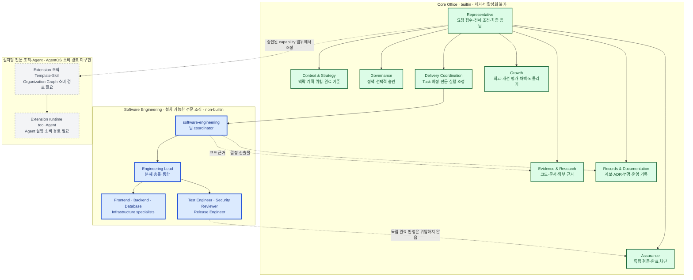

| 조직 유형 | 변경 가능성 | 실행 방식 | 실제 위치 |
|---|---|---|---|
| Core Office 8개 | 제품 migration 외 변경 불가 | Work에 필요할 때 Agent materialize | `packages/organization`, `packages/runtime` |
| Software Engineering 9개 역할 | Profile 계약 구현, 생산 Bootstrap 자동 설치 없음 | 설치 후 격리 Git workspace와 TDD delivery | `packages/software-engineering` |
| Extension 조직·Agent | 설치 수명주기·worker는 구현·조립됨, 조직 Template·Skill·runtime tool의 조직·Runtime 소비 경로는 미구현 | 승인된 Extension은 일반 Node worker로 실행하되, AgentOS에 기여시키는 연결은 아직 없음 | `packages/extension-sdk`, `packages/extension-host`, `packages/runtime`, `apps/server` |

## 5. Work 처리 전체 흐름

대화가 아니라 Work와 불변 사건이 실행·복구의 정본입니다. 개발 작업과 비개발 작업은 Delivery에서 전문 실행 경로가 달라질 수 있지만, 어느 경로도 독립 Assurance와 Records를 생략해 완료할 수 없습니다.

```mermaid
flowchart LR
  classDef implemented fill:#dcfce7,stroke:#166534,color:#14532d,stroke-width:2px;
  classDef implementing fill:#dbeafe,stroke:#1d4ed8,color:#1e3a8a,stroke-width:3px;
  classDef planned fill:#f3f4f6,stroke:#6b7280,color:#374151,stroke-width:1px,stroke-dasharray:5 5;
  classDef external fill:#ffedd5,stroke:#c2410c,color:#7c2d12,stroke-width:2px;

  Request["사용자 요청<br/>Request"]:::implemented
  Intake["대표 조직 접수<br/>Work 생성"]:::implemented
  Context["맥락·전략<br/>ContextVersion · Plan · Criteria"]:::implemented
  Evidence["근거 조사<br/>EvidenceBrief · source revision"]:::implemented
  Delivery{"실행 종류<br/>Delivery Coordination"}:::implemented
  Software["개발 작업<br/>Software Engineering Profile<br/>생산 bootstrap 미연결"]:::implementing
  Domain["비개발 작업<br/>전문 Agent·Tool 또는<br/>Representative 조정 실행"]:::implemented
  Approval{"정책상 승인이<br/>필요한가?"}:::implemented
  Auto["자동 실행<br/>auto 정책"]:::implemented
  Review["사람·조직 승인 대기<br/>review 정책"]:::implemented
  Runtime["Runtime Execution<br/>Task · Assignment · Artifact"]:::implemented
  Verify["독립 검증<br/>Assurance · Verification"]:::implemented
  Records["기록·문서 반영<br/>WorkRecord · ADR · Changelog · Runbook"]:::implemented
  Complete["검증된 Work 완료<br/>completed"]:::implemented
  Growth["회고·개선<br/>Suggestion · Evaluation · Adoption · Revert"]:::implemented

  Request ==> Intake
  Intake ==> Context
  Context ==> Evidence
  Evidence ==> Delivery
  Delivery -->|개발 criterion·Task| Software
  Delivery -->|그 밖의 전문 실행| Domain
  Software --> Approval
  Domain --> Approval
  Approval -->|아니오·auto| Auto
  Approval -->|예·review| Review
  Review -->|승인| Runtime
  Review -.->|거부·취소| Delivery
  Auto --> Runtime
  Runtime ==> Verify
  Verify -->|통과| Records
  Verify -.->|실패·차단·재계획| Delivery
  Records ==> Complete
  Complete ==> Growth
  Growth -. "승인된 개선만 새 버전 적용" .-> Context
```

| 단계 | 주요 정본 | 책임 패키지 |
|---|---|---|
| 접수·업무 | Request, Work, WorkEvent | `packages/work`, `packages/application` |
| 맥락·전략 | ContextVersion, StrategyGeneration, PlanVersion | `packages/context-strategy`, `packages/work` |
| 근거 | RepositoryRevision, IndexVersion, EvidenceBrief | `packages/evidence` |
| 실행 | RuntimeExecution, EngineeringDelivery, ArtifactVersion | `packages/runtime`, `packages/software-engineering`, `packages/work` |
| 검증 | AssuranceRun, criterion·check evidence, Verification | `packages/assurance`, `packages/work` |
| 기록·개선 | RecordsRun, WorkRecord, Growth Suggestion·Effect | `packages/records`, `packages/growth` |

## 6. 실행·승인·차단·취소·복구

핵심 업무 조정기 실행(Application run)은 현재 단계와 실행 임대 세대(lease generation)를 저장합니다. 자동 정책은 사람을 기다리지 않고 진행하고, review 정책만 `awaiting-approval`에서 정지합니다. 모델 부재는 성공이나 일반 실패로 꾸미지 않고 재시도 가능한 `blocked` 상태로 보존합니다.

현재 코드는 `automatic | review | full-access`를 저장하고 실행 계보에 고정합니다. `full-access`는 Massion 승인·Governance 사용자 권한 제한·Workspace 실행 sandbox를 우회하며 Codex·Claude 실행 옵션과 해제 전파까지 구현됐습니다. 전체 원자 Tauri UAT와 긴급 정지 실측은 [ADR-001](ADR-001-personal-full-access.md), [Phase 30 권한 전달 기록](../phases/30-surface-parity-agent-ux/v1-delivery/phase-04-core-collaboration-permission-inbox.md), [개인용 데스크톱 릴리스 기준](../../apps/desktop/src-tauri/RELEASE.md)의 남은 게이트입니다.

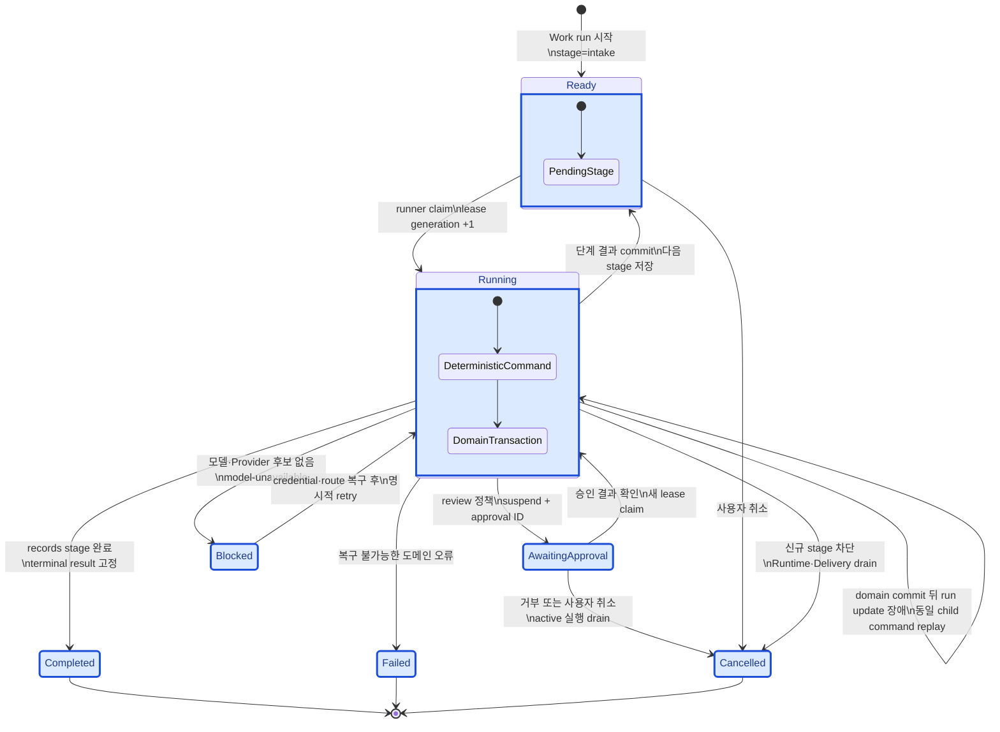

| 상황 | 저장되는 상태 | 복구 원칙 |
|---|---|---|
| 단계 실행 중 process crash | running + lease expiry | 만료 뒤 한 runner만 더 높은 generation으로 회수 |
| 도메인 commit 뒤 run 갱신 실패 | running + 이전 stage | `${runId}:${stage}` command를 replay하고 중복 side effect 차단 |
| 선택적 승인 필요 | awaiting-approval + approval ID | Governance의 영속 결정을 확인한 뒤 재개 |
| 모든 모델 경로 사용 불가 | blocked + reason | credential·route 복구 후 명시적 retry |
| 사용자 취소 | cancelled | 새 stage를 막고 활성 Runtime·Delivery를 먼저 drain |

## 7. 에이전트 협업과 대화

Organization Graph의 활성 노드는 tenant별 Agent map으로 투영됩니다. 제품 의도는 Agent가 상대를 발견해 직접 메시지나 다자 협업방에서 대화하고, 그 메시지·위임·공유 맥락·실행·사용자 개입이 모두 하나의 Work와 인과 계보에 귀속되는 것입니다.

**현재 구현은 이 의도에 도달하지 않았습니다.** 협업방 도메인과 VoltAgent 위임은 각각 구현됐지만 둘이 연결돼 있지 않습니다. 생산 경로에서 협업 메시지를 기록하는 곳은 `packages/application/src/core-pipeline.ts` 두 지점(사용자 요청, Representative handoff)과 Surface가 호출하는 공개 command뿐이며, `packages/runtime/src`는 `postMessage`를 한 번도 호출하지 않습니다. 그래서 실제 방에는 Work당 메시지 두 건만 남고 에이전트 사이의 위임·질문·답변은 VoltAgent 메모리에서 끝납니다.

이 절의 상태 표시는 **도메인이 표현할 수 있는 것**과 **실행 경로가 실제로 만드는 것**을 구분합니다. `packages/work`에 계약이 있다는 사실이 그 대화가 발생한다는 뜻은 아닙니다.

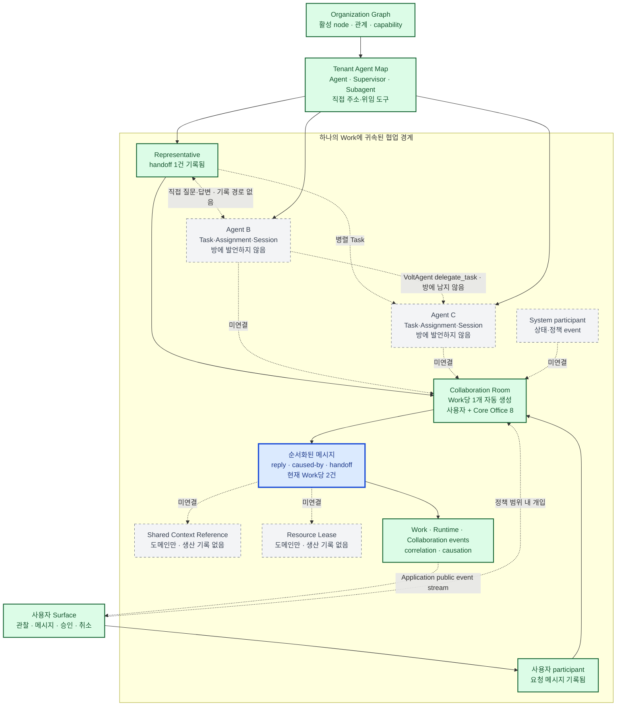

| 협업 요소 | 상태 | 도메인 계약 | 생산 실행 경로 |
|---|---|---|---|
| Agent map·위임 | 구현됨 | `packages/organization` | `packages/runtime/src/voltagent-topology.ts`가 조직 그래프를 supervisor·subAgent로 배선하고 VoltAgent가 위임을 실행 |
| 협업방 생성 | 구현됨 | `packages/work` | `core-pipeline.ts`가 Work마다 `Core Office` 방 하나를 보장. 사용자 + Core Office 8명 참가 |
| 사용자 요청·Representative handoff 기록 | 구현됨 | `packages/work` | `core-pipeline.ts` 두 지점. `replyTo`·`causedBy`로 인과 연결 |
| 사용자 관찰·개입 | 구현됨 | `packages/work` | 공개 command `collaboration.room.open` · `room.join` · `message.post`를 Surface가 호출 |
| **에이전트 간 직접 대화 기록** | 구현됨 (2026-08-09) | `packages/work`에 10종 메시지 타입·인과·순서 계약 존재 | `packages/application/src/collaboration-recorder.ts`가 `delegate_task` 델타를 관찰해 `handoff`·`answer`로 기록. 주입은 `apps/server/src/product.ts`. 결정은 [ADR-004](ADR-004-runtime-collaboration-durability.md) |
| **다자 협업 라운드** | **미구현** | 방에 `max_parallel` · `max_rounds` · `round_count` 존재 | **없음.** 라운드를 진행시키는 실행 경로가 없음 |
| **공유 상태** | **미구현** | `SharedContextReference` · `ResourceLease` 계약과 테스트 존재 | **없음.** 생산 호출 0건 |
| 병렬 실행 | 부분 | `packages/work`의 Task·Assignment | Task 병렬은 동작. 협업방 안의 병렬 발언은 위 항목에 종속 |

`REQ-AGENT-HARNESS-001`(추적표 `in-progress`)이 이 미구현 항목을 요구합니다: *"실제 Agent runtime은 권한과 인과관계를 보존하는 협업 메시지·handoff·memory 계약을 사용하고 실행 계보를 양쪽 화면에 제공합니다."*

## 8. 모델 계정·Provider 라우팅

Agent와 도메인은 실제 모델·계정을 직접 선택하지 않고 논리 모델 경로(Model Route)를 요청합니다. Router는 필수 capability, 데이터 정책, 예산, equivalence group과 평가 점수를 먼저 적용한 뒤 credential 정책으로 계정을 선택합니다. 지원 대상은 Provider가 자동화를 허용한 공식 API key, service account, workload identity와 OAuth이며 소비자 구독의 비공식 cookie·token 자동화는 포함하지 않습니다.

```mermaid
flowchart LR
  classDef implemented fill:#dcfce7,stroke:#166534,color:#14532d,stroke-width:2px;
  classDef implementing fill:#dbeafe,stroke:#1d4ed8,color:#1e3a8a,stroke-width:3px;
  classDef planned fill:#f3f4f6,stroke:#6b7280,color:#374151,stroke-width:1px,stroke-dasharray:5 5;
  classDef external fill:#ffedd5,stroke:#c2410c,color:#7c2d12,stroke-width:2px;

  Request["논리 모델 요청<br/>chat 또는 embedding<br/>capability · data policy · budget"]:::implemented
  Route["Model Route<br/>순서 있는 candidate·equivalence"]:::implemented
  Filter["후보 필터<br/>capability · local-private · eval · cost"]:::implemented
  Pool["Provider Credential Pool<br/>active · cooldown · disabled · revoked"]:::implemented
  Policy{"계정 선택 정책<br/>priority · fill-first · round-robin<br/>weighted · least-used · quota-headroom<br/>reset-aware · sticky"}:::implemented
  Reserve["원자 usage·budget 예약<br/>Attempt와 선택·제외 이유 기록"]:::implemented
  Call["모델 호출<br/>AI SDK · OpenAI-compatible · Ollama"]:::implemented
  Classify{"응답·오류 분류"}:::implemented
  Success["성공<br/>usage 확정"]:::implemented
  NextAccount["같은 Provider의<br/>다음 건강한 credential"]:::implemented
  Equivalent["동급 model candidate<br/>equivalence·eval 재검사"]:::implemented
  NextProvider["다른 Provider·gateway<br/>호환 candidate"]:::implemented
  Blocked["blocked_model_unavailable<br/>제외 이유·재개 가능 시각"]:::implemented
  Stop["fallback 중단<br/>입력·정책·예산·취소·첫 token 이후 실패"]:::implemented
  Providers["공식 Provider API<br/>OpenAI-compatible gateway · Ollama<br/>외부"]:::external

  Request --> Route
  Route --> Filter
  Filter --> Pool
  Pool --> Policy
  Policy --> Reserve
  Reserve --> Call
  Call --> Providers
  Providers --> Classify
  Classify -->|성공| Success
  Classify -->|401·만료| NextAccount
  Classify -->|429·quota·reset| NextAccount
  Classify -->|5xx·timeout·첫 token 전| NextAccount
  NextAccount -->|계정 있음| Reserve
  NextAccount -->|계정 소진| Equivalent
  Equivalent -->|동급 후보 있음| Pool
  Equivalent -->|동급 후보 소진| NextProvider
  NextProvider -->|호환 후보 있음| Pool
  NextProvider -->|모두 소진| Blocked
  Classify -->|비재시도 오류| Stop
```

| 경계 | 보장 | 실제 위치 |
|---|---|---|
| Credential | AES-256-GCM 암호문과 비밀 아닌 metadata만 저장, master key·평문 미기록 | `packages/router` |
| 계정 분산 | 동일 Provider 여러 credential을 결정론적 정책으로 선택 | `packages/router` |
| 모델 fallback | capability·데이터 정책·예산·equivalence·평가 기준을 모두 통과한 후보만 허용 | `packages/router` |
| 제한 모드 | 모델이 없어도 Identity·Work·조직·승인·기록·진단은 계속 동작 | `packages/router`, `packages/application` |

### 8.1 역할별 모델 평가실과 활성 배치

모델 평가실(Model Optimization Lab)은 사용자가 연결하고 검증한 모델만 역할별 평가 묶음으로 실행합니다. 품질·가성비·속도·개인정보 우선·수동 고정 정책 중 하나를 선택해 주 모델과 순서가 있는 fallback을 추천하며, 최초 추천은 승인 전까지 실행 경로에 반영하지 않습니다. 자동 최적화도 조직 정책의 명시적 동의가 있을 때만 최소 표본·개선 폭 게이트를 통과한 배치를 승격합니다.

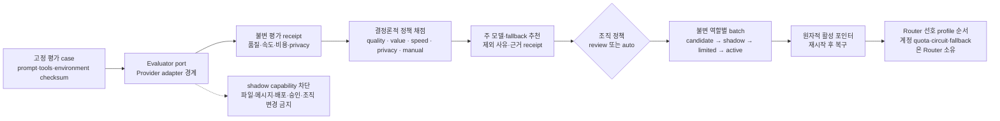

| 평가실 경계 | 보장 | 실제 위치 |
|---|---|---|
| 정본·영수증 | bundle, run, receipt, policy, recommendation, batch, observation, recovery의 tenant 격리와 checksum | `packages/model-optimization` |
| 후보 카탈로그 | 후보를 명시하지 않으면 서버 Router가 연결된 model profile만 제공하며 무료·공개 모델을 자동 추가하지 않음 | `apps/server/src/product.ts` |
| 실행 연결 | Provider별 실행은 `ModelEvaluationExecutor` port를 통해 주입하고 도메인은 Provider SDK를 직접 import하지 않음 | `packages/model-optimization/src/ports.ts` |
| 실사용 경로 | 활성 batch의 primary·fallback profile 순서를 Router에 전달하고 credential·quota·circuit·재시도는 기존 Router가 판정 | `packages/runtime`, `packages/router` |
| 기본 안전값 | 정책이 없으면 review·shadow 비활성, 추천은 `pending-approval`, shadow capability는 모두 차단 | `packages/model-optimization` |

## 9. 데이터·명령·이벤트 계보

SurrealDB는 AgentOS 데이터의 유일한 실행 정본입니다. Surface의 변경 명령은 인증·scope와 replay 원장을 통과하고, 각 도메인이 자신의 transaction 안에서 상태와 불변 event를 함께 기록합니다. Transactional outbox는 그 event의 참조를 같은 commit에 남기며, projector가 조직별 전역 순서를 가진 공개 event로 변환합니다.

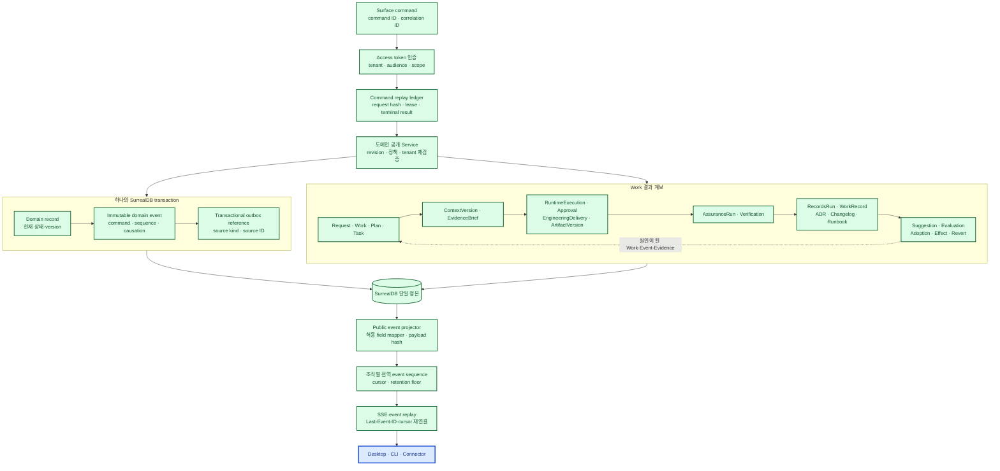

| 계보 구간 | 장애 시 행동 | 실제 위치 |
|---|---|---|
| command replay | 같은 command·같은 payload는 결과 replay, 다른 payload는 거부 | `packages/application`과 각 도메인 command ledger |
| domain transaction | record·event·outbox 중 하나라도 실패하면 전체 rollback | `packages/storage`, `packages/application` |
| public projection | source reference와 허용 mapper로 복구하며 secret·raw row를 반환하지 않음 | `packages/application` |
| Surface reconnect | 조직 cursor 이후 event를 순서대로 replay | `packages/application`, `apps/cli` |
| 결과 추적 | Work에서 실행·검증·기록·개선 원인까지 immutable ID·checksum으로 연결 | `packages/work`, `packages/assurance`, `packages/records`, `packages/growth` |

## 10. Extension·Registry·격리

Extension은 코어 수정 없이 능력을 추가하지만 Core process, SurrealDB 또는 credential을 직접 받지 않습니다. SDK는 정적 manifest·RPC 계약만 제공하고, Host는 artifact 검사·정책·승인·worker 수명주기·health·rollback을 소유합니다. 서버 composition root는 `ExtensionLifecycleService`, `ExtensionGateway`, `RegistryInstaller`를 만들고 Application API의 Extension 명령·조회, artifact install/update, Registry install 경로에 주입합니다. 공개 Registry는 게시·검사·검색·서명·provenance·리콜을 소유합니다.

기본 실행 경계는 OS sandbox, VM 또는 Apple signing을 강제하는 모델이 아닙니다. 승인된 Extension은 별도 일반 Node child process로 실행되고, bounded JSON Lines RPC, manifest 권한, 설치·권한 증가 승인, artifact·출처 계보, worker session·activation 감사와 health·rollback으로 통제됩니다. `ExtensionCapabilityBroker`는 패키지에 구현돼 있지만 현재 서버 composition root가 생성하거나 worker RPC에 연결하지 않으므로, 이 문서는 이를 생산 실행 경로로 표시하지 않습니다.

```mermaid
flowchart LR
  classDef implemented fill:#dcfce7,stroke:#166534,color:#14532d,stroke-width:2px;
  classDef implementing fill:#dbeafe,stroke:#1d4ed8,color:#1e3a8a,stroke-width:3px;
  classDef planned fill:#f3f4f6,stroke:#6b7280,color:#374151,stroke-width:1px,stroke-dasharray:5 5;
  classDef external fill:#ffedd5,stroke:#c2410c,color:#7c2d12,stroke-width:2px;

  Author["Extension 개발자<br/>@massion-ext/name"]:::implemented
  SDK["Extension SDK<br/>manifest v1 · RPC types · author helpers"]:::implemented
  Validate["validate · link · pack<br/>경로·script·manifest·content 검사"]:::implemented
  Artifact["npm 호환 .tgz<br/>byte digest · content manifest"]:::implemented
  Registry["Massion Registry<br/>catalog · trust · signature · provenance<br/>구현됨 · Phase 20"]:::implemented
  Inspect["Host Artifact Inspector<br/>name·version·digest·compatibility·trust"]:::implemented
  Governance["Governance<br/>install · permission increase<br/>auto 또는 review 정책"]:::implemented
  Store["불변 artifact·version 원장<br/>active pointer"]:::implemented
  Supervisor["Worker Supervisor<br/>session · restart · health"]:::implemented
  WorkerProcess["별도 일반 Node child process<br/>승인·권한·감사 경계<br/>OS sandbox·VM·Apple signing 강제 아님"]:::implemented
  Worker["Extension worker<br/>bounded JSON Lines RPC"]:::implemented
  Broker["Capability Broker<br/>구현됨 · production 연결 미구현"]:::planned
  Core["Runtime · Organization · Growth<br/>Records · Surface public ports"]:::implemented
  Database[("SurrealDB")]:::implemented
  Credential["Credential Vault"]:::implemented
  Update["update 후보 health 검사<br/>원자 activate"]:::implemented
  Rollback["직전 healthy version rollback"]:::implemented

  Author --> SDK
  SDK --> Validate
  Validate --> Artifact
  Artifact -. "publish" .-> Registry
  Artifact --> Inspect
  Registry -. "download" .-> Inspect
  Inspect --> Governance
  Governance --> Store
  Store --> Supervisor
  Supervisor --> WorkerProcess
  WorkerProcess --> Worker
  Worker -. "향후 승인된 capability 호출" .-> Broker
  Broker -. "향후 public port" .-> Core
  Core --> Database
  Broker --> Credential
  Store --> Update
  Update --> Supervisor
  Update -. "health 실패" .-> Rollback
  Rollback --> Store
  Worker -. "직접 접근 금지" .-> Database
  Worker -. "secret 원문 접근 금지" .-> Credential
```

| 신뢰 수준 | 활성화 경계 | 실행 책임 |
|---|---|---|
| built-in | artifact·manifest·권한 계보 + Governance 승인 | 같은 Massion release 안의 출처를 표시하고 조직 승인을 기록 |
| verified | 위와 동일 | 검증된 외부 출처를 표시하고, 사용자가 승인한 권한으로 실행 |
| community | 위와 동일 | 커뮤니티 출처를 표시하고, 사용자가 승인한 권한으로 실행 |
| untrusted-local | 위와 동일 | 로컬 출처를 명시하고, 사용자가 책임지고 승인한 권한으로 실행 |

설치·수명주기·Gateway·Registry 설치기와 Application API 조립은 구현됐습니다. 그러나 Extension이 선언한 조직 Template·Skill·runtime tool이 Organization Graph에 반영되거나 Agent 실행이 이를 선택·호출하여 Work·Approval·Audit에 남기는 소비 경로는 미구현입니다. 이는 제품 헌법이 정한 "조직의 역량" 목표를 축소하는 말이 아니라, 그 세로 흐름이 아직 남았다는 현재 구현 진단입니다.

구현 근거는 `apps/server/src/product.ts`, `packages/application/src/artifacts.ts`, `packages/application/src/registry-operations.ts`, `packages/extension-host/src/worker-supervisor.ts`, `packages/extension-host/src/worker-entrypoint.test.ts` 및 각 패키지의 계약·정책·서비스 테스트입니다.

## 11. 개인·팀 배포 구조

현재 코드에는 개인 로컬과 팀 자체 호스팅 배포 변형이 모두 남아 있습니다. 그러나 다음 메인 릴리스는 한 명의 owner가 쓰는 개인용 macOS arm64 데스크톱만 대상으로 합니다. Compose·Kubernetes와 팀 배포 코드는 개인용 1.0 완료 근거가 아니며 후속 범위입니다. 개인 모드도 조직·Work·승인·Assurance 데이터 모델을 축약하지 않습니다.

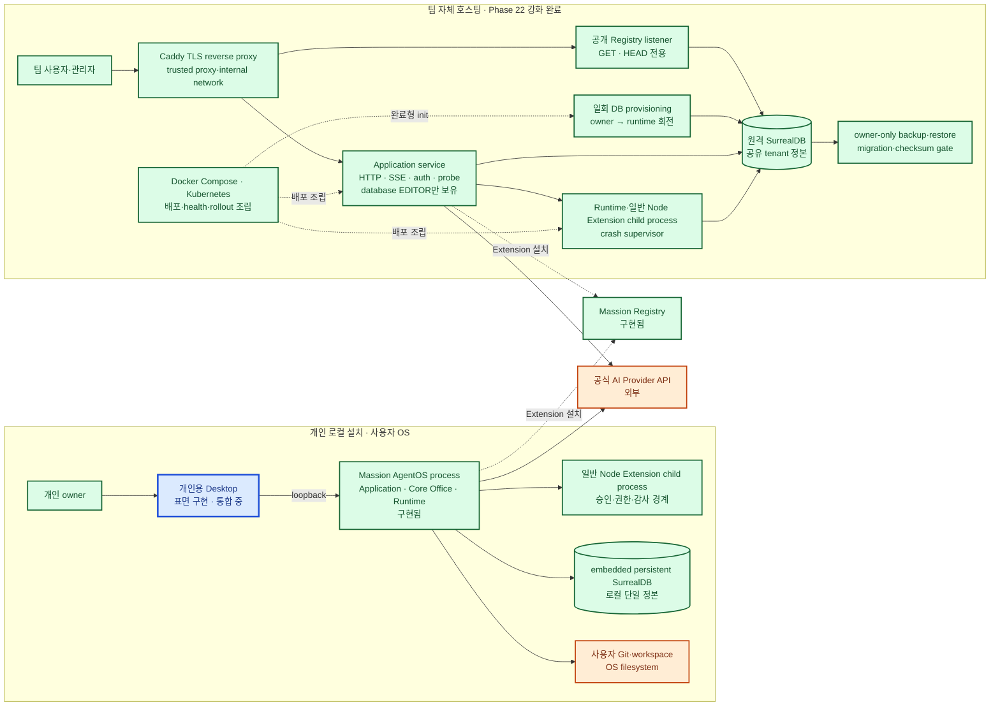

| 배포 변형 | 현재 상태 | 신뢰·운영 경계 |
|---|---|---|
| 개인 로컬 | Desktop 표면 구현, Application·daemon 연결과 릴리스 검증 진행 중 | macOS arm64, loopback bootstrap, OS 사용자 권한, 로컬 DB 경로당 단일 연결 |
| 팀 자체 호스팅 | Compose 실행·읽기 전용 Registry·owner/runtime 분리 검증, Kubernetes 1.34 schema 검증 완료 | TLS, database 범위 runtime auth, tenant 격리, shared DB, Extension 설치 승인·출처·권한·감사, backup·restore |
| 관리형 Massion Cloud | 1.0 범위 밖 | 호환 가능한 멀티테넌트 계약만 유지하고 내부 구조는 이 문서에서 설계하지 않음 |

## 12. 구현 위치와 Phase 상태 색인

| 영역 | 상태 | 구현·설계 위치 | Phase |
|---|---|---|---|
| 저장소·Identity·Organization | 구현됨 | `packages/storage`, `packages/identity`, `packages/organization` | 현재 코드 |
| 기반 계약 | 코드 존재·생산 소비자 0 | `packages/foundation` | Node 24 런타임 가드 3함수뿐이며 저장소 전체에서 import 0건, 어떤 `package.json`의 dependencies에도 없음 |
| Work·Router·Runtime·Governance | 구현됨 | `packages/work`, `packages/router`, `packages/runtime`, `packages/governance` | 5~8 |
| Context·Evidence·Engineering·Assurance·Records·Growth | 구현됨 | `packages/context-strategy`, `packages/evidence`, `packages/software-engineering`, `packages/assurance`, `packages/records`, `packages/growth` | 9~14 |
| Extension SDK·Host | 구현됨 | `packages/extension-sdk`, `packages/extension-host`, `apps/server` | Application API에 Extension Host와 Registry 설치기 조립 |
| Application API·CLI | 구현됨 | `packages/application`, `apps/cli` | 16 |
| TUI | 제거됨 | — | 17 |
| Web Console | 제거됨 | — | 18 |
| Slack·Discord·GitHub 공식 통합 | 구현됨 | `packages/integrations`, `extensions/*` | 19 |
| Registry·Marketplace | 구현됨 | `packages/registry`, `packages/application`, `apps/cli` | 20 |
| 자체 호스팅·운영 | 구현됨 | `apps/server`, `compose.yaml`, `deploy/kubernetes`, `docs/operations` | 21 |
| 보안·성능·복구 강화 | 구현됨 | `apps/server`, `packages/registry`, `scripts/verify-security.mjs`, `scripts/hardening-load.mjs` | 22 |
| 레거시 배포 묶음 E2E | 코드 존재·공개 릴리스 철회 | `apps/distribution`, `release`, `scripts/build-release.mjs`, `scripts/verify-release.mjs`, `.github/workflows/release.yml` | 23 |
| 개인용 데스크톱 1.0 릴리스 | 진행 중 | `apps/desktop`, `docs/phases/30-surface-parity-agent-ux/v1-delivery/README.md` | 30 |
| 모델 평가실·역할별 배치 | 구현 중 | `packages/model-optimization`, `packages/router`, `packages/runtime`, `apps/server`, `apps/cli` | 25 |

이 문서의 상태가 현재 코드와 달라지면 실제 검증 근거를 확인한 뒤 그림과 표를 함께 갱신합니다.

### 검증 기록

2026-07-13 공개 저장소 전환 후 다음 검증을 다시 실행했습니다.

| 검증 | 결과 |
|---|---|
| `pnpm verify:architecture` | Mermaid CLI 11.16.0으로 다이어그램 11개 SVG 렌더링 통과 |
| `node --test scripts/verify-docs.test.mjs` | 문서 검증기 테스트 10개 통과 |
| `node scripts/verify-docs.mjs` | Phase 구조·요구사항 추적표·로컬 링크 검사 통과 |
| `pnpm build` | 29개 workspace package 빌드 통과 |
| `pnpm verify:security` | 보안 테스트 파일 14개, 테스트 67개 통과·1개 조건부 생략, moderate·high·critical advisory 0 |
| `git diff --check` | 공백·충돌 표식 검사 통과 |

로컬 검증 스크립트는 설치된 Chrome·Chromium을 사용합니다. 자동 탐지 경로에 브라우저가 없으면 `MASSION_MERMAID_BROWSER` 환경 변수에 실행 파일 경로를 지정합니다.
